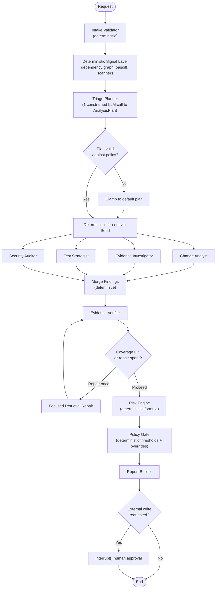
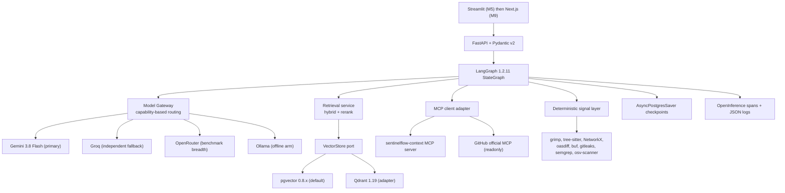

# SentinelFlow

## Agentic Release Intelligence and Evidence-Grounded Quality Gate

**Status:** canonical plan. This document supersedes [SentinelFlow_One_Week_Project_Plan.md](SentinelFlow_One_Week_Project_Plan.md) and [SentinelFlow_Multi_Agent_Architecture.md](SentinelFlow_Multi_Agent_Architecture.md). Where those two disagree, this document wins. [Top 3 Portfolio Projects.md](Top%203%20Portfolio%20Projects.md) remains background market research only.

**Organizing principle:** milestones with exit criteria, not calendar weeks. A milestone is done when its gate passes, however long that takes.

**Verification date:** every version number, model ID, package name, and price in this document was checked against primary sources on 2026-09-15. Section 13 lists what was wrong in the prior docs.

---

## 1. What SentinelFlow is

SentinelFlow ingests a proposed software change (a pull request or a change ticket) and answers three questions with citations:

1. What could break, and how far does the blast radius reach?
2. What evidence supports or contradicts that conclusion?
3. Should this release pass, require human review, or be blocked?

**One-line pitch:**

> SentinelFlow is a multi-agent release-risk gate that converts a code change into an evidence-cited impact analysis, a prioritized regression plan, and an auditable pass/review/block decision — with the decision computed by a deterministic risk engine rather than invented by a language model.

That last clause is the thesis of the whole project. Language models generate *findings*; code computes *verdicts*. Everything in the architecture follows from that split.

### The load-bearing differentiator

Most multi-agent portfolio projects are LLMs talking to LLMs. SentinelFlow grounds every risk signal in a real deterministic tool before an agent is allowed to interpret it:

- Blast radius comes from an actual import/dependency graph (`grimp` + Tree-sitter + NetworkX), not from asking a model what it thinks depends on what.
- API breaking changes come from `oasdiff`, which emits a severity-graded verdict against the declared contract.
- Security findings come from `gitleaks`, `semgrep`, and `osv-scanner`.
- The risk score is a versioned, unit-tested, weight-calibrated formula over those signals.

An interviewer can therefore ask "how do you know the model didn't hallucinate the impact?" and the answer is "it didn't compute the impact — this function did, here are its tests."

---

## 2. Decision: orchestration pattern

**Chosen: deterministic graph with a single typed planning node. Rejected: supervisor-routed agents.**

The two prior documents disagreed. The one-week plan used a fixed LangGraph with hardcoded edges; the architecture doc proposed a Supervisor/Orchestrator agent that decides which specialists to invoke. Neither is right as written.

- A **fully static graph** cannot skip irrelevant work. Running the Security Auditor on a documentation-only change wastes tokens and pollutes the risk score with a null finding. Expressing "run security only if auth/secrets/dependency surfaces are touched" as hardcoded edges means encoding change taxonomy into graph topology, which does not scale past a handful of cases.
- A **supervisor agent** spends an LLM call per routing decision on a decision that is mostly deterministic, makes the execution trajectory nondeterministic, and therefore makes trajectory assertions in the eval harness impossible. You cannot write `assert nodes_executed == expected` when a model picks the nodes. It also creates a single point of prompt failure in front of the entire pipeline.

**The reconciliation:** one bounded LLM call classifies the change into a typed `AnalysisPlan`. Deterministic code then validates that plan against a policy allowlist and fans out over it. The model proposes; the graph disposes.



**Why this is the defensible answer in an interview:** the LLM is used where judgment is genuinely required (what kind of change is this, what does this evidence mean) and code is used where determinism is required (which nodes run, in what order, under what budget, producing what verdict). The plan itself becomes an evaluable artifact — plan-selection accuracy is measured separately from execution quality.

---

## 3. Final agent roster

These names are **frozen**. They appear in code, traces, documentation, and resume bullets, and they will not change.

There are **five specialist agents**. Deterministic nodes are not agents and are never counted as such.

| # | Agent | Mission | Tools and context | Typed output | Why it is separate |
|---|---|---|---|---|---|
| 1 | **Change Analyst** | Interpret the change: map the diff to components, contracts, and data flows; explain the deterministic blast-radius and contract-diff signals; emit ranked risk hypotheses | MCP `get_change_package`, MCP `get_dependency_graph`, MCP `diff_contracts`; no RAG | `ChangeImpact` | Owns code-and-topology reasoning; needs repo and graph context, never policy prose |
| 2 | **Evidence Investigator** | Find authoritative support or contradiction for each hypothesis; return cited evidence with coverage accounting | RAG retriever only; no MCP | `EvidenceBundle` | Retrieval is independently optimizable and independently measurable; isolating it lets retrieval quality be evaluated without agent confounds |
| 3 | **Test Strategist** | Produce the minimum sufficient regression plan, prioritized with rationale; optionally execute allowlisted tests | MCP `list_tests`, MCP `run_tests` (sandboxed, dry-run default) | `RegressionPlan` | Test selection has its own coverage objective and its own tool permissions, including the only execution capability in the system |
| 4 | **Security Auditor** | Interpret scanner output and auth/authz/data-exposure surface changes in context; distinguish real exposure from noise | MCP `run_security_scan` output, MCP `get_dependency_graph`, security-scoped RAG | `SecurityFindings` | Different rubric, different severity model, and different false-positive economics than functional risk |
| 5 | **Evidence Verifier** | Adversarially check every material claim against cited evidence; detect cross-agent contradictions; flag unsupported assumptions and injected instructions | Read-only structured outputs plus the retrieved evidence set; no external tools | `VerificationReport` | An independent critic with no stake in the findings reduces self-confirmation; also the arm isolated in the baseline comparison |

### Reconciliation decisions, stated explicitly

- **Change Analyst absorbs the architecture doc's separate "Code Risk Agent."** Both needed the same inputs (diff plus dependency graph) and the same tools. Splitting them created a handoff that added latency and a serialization boundary without adding capability. Agents earn separation by having distinct tools, context, or rubrics — not by having distinct nouns.
- **The Supervisor/Orchestrator agent is deleted.** Its responsibilities are redistributed: task classification to the Triage Planner node, budget enforcement to middleware, state to LangGraph, retries to per-node `RetryPolicy`, approval to `interrupt()`.
- **The Decision/Report Agent is deleted and becomes deterministic code.** The architecture doc's own "what not to build" list warns against a confidence score generated directly by an LLM. Taking that seriously means the decision node cannot be an agent.
- **"Risk Reviewer" and "Evidence Verifier" merge into Evidence Verifier.** Once scoring moves into the risk engine, what remains of the one-week plan's Risk Reviewer is exactly claim verification. The name `Evidence Verifier` is also what the eval baselines isolate ("multi-agent + verifier"), so the naming and the experiment agree.
- **Security Auditor**, not "Security Reviewer," to avoid two agents whose names both end in "Reviewer."

### Deterministic nodes (not agents)

Intake Validator, Deterministic Signal Layer (dependency graph, contract differ, security scanners), Triage Planner (one constrained classification call, no tools, no free-text reasoning surface), Merge Findings, Focused Retrieval Repair, Risk Engine, Policy Gate, Report Builder, Human Approval checkpoint.

The Triage Planner is the one honest edge case: it makes an LLM call. It is documented as a planning node rather than counted as a sixth agent because it holds no tools, produces only a closed-vocabulary enum plan, and is clamped by policy. Resume claims say five agents.

---

## 4. Deterministic risk engine

The LLM never emits the score. The engine is a pure function of typed signals, versioned, unit-tested, and weight-calibrated against labeled scenarios.

```
RiskScore = clamp(0, 100,
    25 * blast_radius_norm         # depth-weighted reverse reachability over the dependency graph
  + 20 * critical_service_norm     # criticality tiers of impacted services, from the domain pack
  + 15 * contract_break_norm       # oasdiff ERR/WARN counts; buf breaking for protobuf
  + 15 * security_severity_norm    # max severity and count from gitleaks / semgrep / osv-scanner
  + 15 * test_gap_norm             # required-but-absent tests vs. the repo test inventory
  +  10 * incident_similarity_norm # retrieval similarity to prior incidents, deterministic over scores
  -  10 * evidence_confidence_norm # penalty: unsupported-claim rate from the Evidence Verifier
)
```

Every `_norm` term is a documented function with its own unit tests and a defined range of `[0, 1]`. The weights come from the architecture doc's priors but are **calibrated, not asserted**: a grid search over the golden set maximizes decision accuracy, and the plan reports pre- and post-calibration accuracy so the calibration is itself an artifact rather than a claim.

### Hard overrides that bypass the score

A numeric threshold alone is insufficient for a safety gate, so policy rules can force an outcome:

| Condition | Forced outcome |
|---|---|
| `oasdiff` reports `ERR` on a service tagged `criticality: critical` | `BLOCK` |
| Verified secret exposure in the diff | `BLOCK` |
| Any critical claim unsupported after the single repair attempt | `REVIEW` |
| Evidence coverage below the domain pack's floor | `REVIEW` |
| Dependency vulnerability at or above the pack's severity ceiling | `BLOCK` |

Thresholds and overrides live in the domain pack's `policy.yaml`, never in code. Changing risk appetite is a config change, and the eval harness can measure decision accuracy across different policy configurations.

---

## 5. Domain packs: making the story portable

The domain must be swappable so the same project pitches to fintech, e-commerce, infrastructure, or healthcare. A single configurable domain proves nothing; **two shipped packs prove it**.

```text
domains/
├── healthcare-claims/          # default
│   ├── domain.yaml             # services, criticality tiers, data-classification labels
│   ├── dependencies.yaml       # seed graph, augmented by static analysis
│   ├── policy.yaml             # thresholds, override rules, evidence floor, required approvals
│   ├── knowledge/              # requirements, contracts, ADRs, runbooks, incidents, test plans
│   ├── fixtures/changes/       # seeded change packages
│   └── scenarios/golden.jsonl  # labeled evaluation scenarios
└── ecommerce-payments/         # second pack, same schema, different vocabulary
```

**Enforcement, not aspiration:** a CI test greps `app/` for domain vocabulary (`claim`, `payer`, `remittance`, `checkout`, `cart`, and so on) and fails the build on a hit. Domain terms may exist only under `domains/`. This converts "config-driven" from a README adjective into a tested property.

**Portfolio payoff:** the evaluation runs both packs and reports metrics per pack. The interview line becomes "the same engine scores a claims platform and a payments platform; here are both result tables," which is materially stronger than "it could be adapted."

---

## 6. Architecture and tech stack

All versions verified 2026-09-15.



### Core runtime

| Concern | Choice | Version | Note |
|---|---|---|---|
| Language | Python + `uv`, Ruff, mypy, pytest | 3.12 | |
| API | FastAPI + Pydantic v2 | current | Typed boundary, DI for fakes in tests |
| Orchestration | `langgraph` | 1.2.11 | `StateGraph`, `Send` fan-out, `defer=True` fan-in |
| Framework | `langchain` / `langchain-core` | 1.4.0 / 1.6.3 | v1 GA; `create_agent`, not `create_react_agent` |
| Checkpoints | `langgraph-checkpoint-postgres` / `-sqlite` | 3.1.2 / 3.1.1 | `AsyncPostgresSaver`, `.setup()` required |

### Models and providers

| Role | Choice | Note |
|---|---|---|
| Primary generation | `gemini-3.8-flash` via `langchain-google-genai` 4.4.0 | Current flash tier. Half the input cost and 40 percent less output cost than the legacy `gemini-3.5-flash` the prior docs specified |
| Cheap tier | `gemini-3.5-flash-lite` / `gemini-3.1-flash-lite` | Free-tier eligible; used for the Triage Planner classification |
| Embeddings | `gemini-embedding-2` | 8,192-token input, automatic renormalization at truncated dimensions. Chosen over `gemini-embedding-001` because embedding spaces are incompatible and switching later means re-embedding everything |
| Independent fallback | Groq, `openai/gpt-oss-120b` | Replaces NVIDIA NIM. Publishes real limits, and `strict: true` constrained decoding guarantees schema conformance |
| Benchmark breadth | OpenRouter | One-time $10 purchase raises the daily cap from 50 to 1,000 requests, which is what makes a real benchmark feasible |
| Offline arm | Ollama, local Llama | Zero-cost eval arm and the air-gapped-deployment talking point |

**Open empirical question, resolved by measurement in M4:** both prior docs specify temperature 0.0–0.2. But `langchain-google-genai` deliberately defaults Gemini 3.x to `temperature=1.0` because 0.7 "can cause infinite loops, degraded reasoning performance, and failure on complex tasks." The QA instinct toward low temperature may not transfer. M4 runs a sweep at 0.0 / 0.2 / 1.0 measuring schema-validity rate, trajectory stability, and decision accuracy, and adopts whatever the data supports. This becomes a documented finding rather than an assumption.

### Retrieval

Both vector stores sit behind one `VectorStore` port, with pgvector as the default and a documented benchmark comparing them.

| Concern | Choice | Note |
|---|---|---|
| Default store | pgvector 0.8.x on Neon, via `langchain-postgres` 0.0.18 | **`PGVectorStore`, not `PGVector`** — the latter is deprecated since 0.0.14 |
| Hybrid (Postgres) | `hybrid_search_config` with `reciprocal_rank_fusion` | Lexical half is `tsvector` + GIN, not BM25; fusion happens client-side across two queries. A `tsvector` column must be provisioned explicitly |
| Adapter store | Qdrant 1.19.0 via `langchain-qdrant` 1.1.0 | `RetrievalMode.HYBRID`, sparse BM25 via `FastEmbedSparse("Qdrant/bm25")`, server-side RRF/DBSF in one Query API call |
| Reranker (default) | `BAAI/bge-reranker-v2-m3` or `Qwen/Qwen3-Reranker-0.6B` | Apache 2.0, CPU-viable at demo scale, via `CrossEncoderReranker` |
| Reranker (hosted comparison) | Voyage `rerank-2.5-lite` | 200M free tokens, the most generous grant available |
| Explicitly rejected | Jina `jina-reranker-v3.5` | CC BY-NC-4.0. Strong model, but non-commercial licensing is the wrong dependency for a portfolio centerpiece |

The pgvector-versus-Qdrant comparison is an honest one to run and report: Postgres wins on operational simplicity (one datastore already needed for checkpoints and audit), Qdrant wins on genuine server-side fusion. Measuring both and stating the tradeoff is worth more than picking one silently.

### MCP boundary

| Concern | Choice | Note |
|---|---|---|
| Spec revision | `2026-07-28` | Current. Note this revision made the protocol **stateless**: no `initialize` handshake, no sessions, no `Mcp-Session-Id` |
| Server SDK | `mcp` 2.2.0, `from mcp.server import MCPServer` | **`FastMCP` was removed, not deprecated.** All attributes are snake_case in Python, camelCase on the wire |
| Client (default) | Own typed adapter over the official SDK `Client` | One MCP stack, no beta churn, and the tool-loading and validation boundary is defensible code |
| Client (documented alternative) | `langchain[mcp]` `MCPAdapter` behind the same port + ADR | Beta, and built on third-party `fastmcp` 4.x rather than the official SDK, so adopting it means two MCP stacks |
| Retired | `langchain-mcp-adapters` | Unmaintained and pinned to `mcp<2.0.0`, so it cannot coexist with the current SDK |
| Live change data | GitHub official MCP server, `https://api.githubcopilot.com/mcp/` | GA since Sept 2025. Use the `/readonly` toolset URLs |

**Own server (`sentinelflow-context`) tools:** `get_change_package`, `get_dependency_graph`, `diff_contracts`, `list_tests`, `run_tests` (sandboxed, `dry_run=True` default), `run_security_scan`, `record_gate_decision` (write, human-approved, idempotent).

**Resources:** `service-catalog://current`, `release-policy://current`, `dependency-graph://current`.

The scope of the custom server narrowed once GitHub's server was confirmed GA. `pull_request_read` already dispatches `get_diff`, `get_files`, `get_commits`, `get_status`, and `get_check_runs`, and `get_job_logs` has a `failed_only` flag. Building a GitHub adapter would have been reinventing a permission-scoped, GA integration. What remains custom is what GitHub genuinely cannot provide: the dependency graph, the release policy, test selection, and the audited decision record.

### Deterministic tool layer

| Signal | Tool | Note |
|---|---|---|
| Python import graph | `grimp` 3.17 | `find_downstream_modules(as_package=True)` is transitive reverse reachability directly |
| Polyglot parsing | `tree-sitter` 0.26 + per-language grammars | `tree-sitter-languages` is unmaintained; the query API changed in 0.25 (`Query` + `QueryCursor`) |
| Graph | `networkx` 3.6.1 | Right-sized for hundreds of nodes. No graph database; Apache AGE for PG18 is still a release candidate |
| OpenAPI breaking changes | `oasdiff` 1.32.1 via `tufin/oasdiff` container | No PyPI package exists, so the MCP tool shells out to the container |
| Protobuf | `buf breaking` 1.73.0 | Rules split by FILE / PACKAGE / WIRE_JSON / WIRE |
| Secrets | `gitleaks` 8.30.1 | MIT. Chosen over AGPL-licensed trufflehog, whose verification also needs network egress |
| SAST | `semgrep` CE 1.177.0 | LGPL engine. Rules are under a restrictive license — use custom or permissively-licensed rules only |
| Dependencies | `osv-scanner` 2.6.0 | Lockfile-first, offline-capable, CycloneDX output, OSV advisory provenance |
| Explicitly rejected | CodeQL | Its license forbids both CI use and non-open-source codebases without paid GHAS |

**Confidence layering, deliberately:** `grimp` edges are resolver-accurate; Tree-sitter edges are heuristic. The graph tags each edge with its provenance and the report distinguishes them. Presenting a regex-grade edge with the same confidence as a resolved import would undermine the entire deterministic premise.

**Scoped out of v1:** Avro and JSON Schema compatibility verdicts. No mature Python checker exists — `jsoncompat` self-describes as alpha that "can still miss incompatible changes," and `wisen` says it is not production-ready. OpenAPI and Protobuf coverage is honest; faking Avro coverage is not.

### Sandbox, persistence, deployment, observability

| Concern | Choice | Note |
|---|---|---|
| Test execution sandbox | Hardened `docker run` | `--network=none`, `--read-only`, `--cap-drop=ALL`, `--security-opt=no-new-privileges`, `--pids-limit`, memory and CPU caps, non-root, digest-pinned. gVisor `--runtime=runsc` documented as a one-flag upgrade |
| Local persistence | SQLite + `AsyncSqliteSaver` + local Postgres in Compose | |
| Deployed persistence | Neon Postgres | Permanent free tier, scale-to-zero after 5 min idle, **not deleted** — unlike Supabase (pauses after 1 week, manual unpause) or Render (expires after 30 days) |
| Deployment | Cloud Run, request-based billing, Terraform | Request-based mode is what carries the 2M-request free allowance; instance-based has no request free tier |
| Tracing | OpenInference instrumentation | Chosen over betting on OTel `gen_ai.*`, which is entirely `Development` status, moved repositories in v1.42.0, and has no tagged release to pin |
| Trace sink | Local JSON + OTLP; LangSmith for demo runs only | LangSmith free tier is 5,000 traces/month with a hard cap absent a payment method. A nested multi-agent eval run would exhaust it, so `LANGSMITH_TEST_CACHE` gates CI |
| Load testing | Locust 2.46.5 for the API; GuideLLM 0.7.3 for the generation path | `llmperf` was archived Dec 2025. Locust cannot measure TTFT and its GIL-bound tokenization inflates the inter-token latency it tries to measure |

---

## 7. Graph engineering details that matter

These are specific, verified LangGraph behaviors that a naive implementation gets wrong.

- **Set the recursion limit explicitly.** The default is now **1000** supersteps, not the 25 that most tutorials and both prior docs assume. A runaway loop at 1000 LLM calls is a real cost incident. Set it low and use the `RemainingSteps` managed value to degrade into a `REVIEW` verdict rather than raising `GraphRecursionError`.
- **Use `Overwrite` to clear accumulator fields.** Returning `[]` against an `Annotated[list, add]` reducer merges the empty list rather than clearing it. The single-repair-loop design would silently accumulate stale evidence gaps forever without `Overwrite([])`.
- **`defer=True` on the Merge Findings node.** The four fan-out branches will not have equal depth, and without deferral the merge fires once per superstep in which any branch completes.
- **`durability="sync"`.** The default is `"async"`, which risks losing a checkpoint if the process dies mid-write. When every node is an expensive LLM call, paying latency for crash consistency is correct.
- **Parallel ordering is not guaranteed.** Write an explicit sort key alongside each fan-out result; do not depend on arrival order.
- **Supersteps are transactional.** If any parallel branch raises, none of that superstep's updates apply. Per-node `RetryPolicy` and timeouts (which require `langgraph>=1.2`) contain failures at the node rather than the superstep.
- **`subgraphs=True` when streaming.** `create_agent` returns a compiled graph, so wrapping one as a node silently suppresses its token stream from the parent without this flag.
- **Node naming affects the UI.** The agent's internal LLM node is named `"model"` in v1, not `"agent"`. SSE progress filtering keys off node names.
- **Streaming surface:** `astream(..., version="v2")` for its uniform `StreamPart` shape. `stream_events(version="v3")` is what current docs showcase but is explicitly experimental; `astream_events(version="v1")` is slated for removal. There is no official FastAPI SSE recipe, so the HTTP wiring is ours to own and test.

---

## 8. Phased build roadmap

Organized as vertical slices with exit gates. No calendar weeks. The ordering embeds one deliberate inversion from both prior docs: **the deterministic layer is built before any agent exists.**

### M0 — Contracts and skeleton

Pydantic domain models for every agent output; the `AnalysisState` graph state; domain-pack loader with both packs stubbed; FastAPI skeleton with health endpoints; `uv` project, Ruff, mypy strict, pytest; CI pipeline; ADR directory seeded.

**Exit:** mypy strict and Ruff clean; the domain-vocabulary leak test passes; both packs load and validate against their schema.

### M1 — Deterministic signal layer (before any LLM)

Dependency graph builder (`grimp` for Python, Tree-sitter for the rest, merged into a provenance-tagged NetworkX `DiGraph`); reverse-BFS blast radius with depth caps; `oasdiff` and `buf` wrappers; `gitleaks`, `semgrep`, `osv-scanner` wrappers; the risk engine with unit tests per `_norm` term; the policy gate with override rules.

**Exit:** every fixture change in both packs produces a risk score and a policy verdict with **zero LLM calls**, and the risk-engine unit tests cover each term's boundary conditions.

**Why first:** this gives the system a defensible spine before a single prompt exists, and it hands the eval harness a free non-LLM baseline. If the deterministic layer alone scores decisions well, that is a finding worth reporting, not a threat.

### M2 — MCP boundary

`sentinelflow-context` server on `mcp` 2.2.0 with the seven tools and three resources; typed structured outputs via return annotations; `ToolError` versus `MCPError` discipline; own client adapter over the official `Client`; MCP Inspector verification; GitHub official MCP readonly wired as the live change source behind the same port as fixtures.

**Exit:** contract tests cover valid, invalid, and malicious inputs for every tool; agents can reach change data *only* through the MCP client; the same scenario runs identically against a fixture and against a real GitHub PR.

### M3 — Retrieval

Corpus authoring for both packs (structure-aware chunking: markdown by heading, OpenAPI by endpoint and schema object, incidents by section); `PGVectorStore` with a provisioned `tsvector` column and GIN index; hybrid retrieval with RRF; the Qdrant adapter; reranker integration; a retrieval-only eval harness with recall@k, MRR, and nDCG.

**Exit:** recall@10 for required evidence meets the target on the retrieval subset; the reranker ablation (none / bge / Voyage) is measured and reported; the pgvector-versus-Qdrant comparison has real numbers.

### M4 — Agents and graph

Five agents with versioned prompts and typed outputs; the Triage Planner; `Send` fan-out with `defer=True` fan-in; the evidence-ID validator; one bounded repair loop using `Overwrite`; `interrupt()` approval before `record_gate_decision`; checkpointing with `durability="sync"`; budget middleware.

**Exit:** full trajectory completes on a scenario sample with **100 percent citation validity** and zero invented evidence IDs; approval pauses and resumes correctly on the same thread; the temperature sweep is complete and the chosen value is documented with data.

### M5 — API, streaming, and harness UI

Job lifecycle with idempotency keys; SSE progress endpoint; decision endpoint; evaluation trigger endpoint; machine-readable error codes; Streamlit UI as a working harness.

**Exit:** the entire demo runs through HTTP, not direct Python calls; SSE streams node-level progress including inner agent tokens.

### M6 — Evaluation

Golden set scaled to 60–80 labeled scenarios across both packs; the five baseline arms; the provider and cost matrix; risk-weight calibration; `deepeval` harness with deterministic assertions plus a calibrated LLM judge; CI gate on a cached deterministic subset.

**Exit:** all five arms have measured results with variance across repeated runs; the calibration report shows pre- and post-calibration decision accuracy; CI fails on regression.

### M7 — Security and resilience

Prompt-injection suite from vendored InjecAgent and Lakera Gandalf fixtures; `promptfoo` with a local provider for adversarial generation; sandbox hardening verification; failure injection (provider outage, MCP timeout, malformed structured output, empty retrieval); budget and timeout enforcement tests; Locust and GuideLLM load runs.

**Exit:** injection suite is green and runs offline with no API keys; every failure mode returns a typed partial `REVIEW` rather than a crash; load results establish where a queue would become necessary.

### M8 — Deployment

Terraform for Cloud Run (request-based billing), Neon, Artifact Registry, and Secret Manager; container hardening; readiness checks; warm-up documentation for cold starts.

**Exit:** a fresh clone deploys via `terraform apply` plus one command; the deployed demo contains no secrets and only synthetic data.

### M9 — Next.js UI and portfolio artifacts

React/TypeScript UI with live graph execution and an evidence explorer; README; architecture diagrams; ADRs; measured results tables; three-minute demo video.

**Exit:** a reviewer can go from repository link to understanding the thesis in under two minutes, and from clone to running demo without asking a question.

---

## 9. Evaluation methodology

Evaluation is the primary deliverable, not a section of the README. It is what converts "I built a multi-agent system" into "I measured whether multi-agent was worth it."

### Baseline comparison — five arms

| Arm | Configuration | What it isolates |
|---|---|---|
| **B0** | Single LLM, diff only, no retrieval, no tools | The floor. How much can a model infer unaided? |
| **B1** | Single LLM + RAG | The value of retrieval alone |
| **B2** | Single agent + RAG + all MCP tools | The value of tools without specialization |
| **B3** | Five agents, no verifier, LLM-generated risk score | The value of specialization |
| **B4** | Five agents + Evidence Verifier + deterministic risk engine | The value of verification and deterministic scoring |

B2 versus B3 is the honest test of whether multi-agent earns its cost. B3 versus B4 is the test of the project's central thesis. **If B2 matches B3, that result gets published in the README.** A portfolio project that reports a negative result about its own architecture is far more credible than one that reports only wins, and "I measured it and here is where the added complexity did and did not pay" is a materially stronger interview answer than an unfalsifiable claim.

### Metrics

Per-arm and per-domain-pack: impacted-service precision and recall; required-test recall; decision accuracy (PASS/REVIEW/BLOCK) and F1; citation validity; unsupported-claim rate; tool-selection accuracy; trajectory conformance; schema-validity rate; retrieval recall@k, MRR, and nDCG; workflow completion rate; p50/p95 latency; tokens and cost per analysis.

### Provider and cost matrix

The same golden set executed across `gemini-3.8-flash`, `gemini-3.5-flash-lite`, two or three OpenRouter models, Groq `openai/gpt-oss-120b`, and local Ollama — reporting quality, latency, and cost per arm. **Real executed runs with measured numbers**, per your requirement, not projections.

### Statistical honesty

A 60–80 scenario set cannot support strong claims about small differences. The report therefore states N, runs three seeds per configuration, reports variance and confidence intervals, and explicitly says which differences are within noise. Stating that limitation is a maturity signal; hiding it behind a single-run table is the thing experienced reviewers notice.

The LLM judge is calibrated against manually scored cases and reported as a secondary metric, never as the headline number.

---

## 10. What is worth the extra time, and what is not

You asked for this judgment explicitly rather than padded scope.

### Worth it

| Item | Why |
|---|---|
| **Deterministic tool layer** | The single highest-value item. It is what makes the project not-a-demo, and it is why the risk score is defensible |
| **Real GitHub MCP integration** | Now nearly free since the server is GA. Dual-mode gives reproducible evaluation *and* a live demo |
| **Real dependency graph** | Directly enables blast radius, which is the most interesting signal in the system |
| **Five-arm baseline comparison** | Converts architecture assertions into measurements. The highest-signal artifact for senior interviews |
| **Executed provider benchmark** | Proves the abstraction is real; demonstrates cost-consciousness with numbers |
| **Second domain pack** | Cheap once the pack schema exists, and it is the only way "config-driven" becomes credible |
| **Reranking with ablation** | Only worth it *because* it is measured. A reranker with no measured delta is decoration |
| **Prompt-injection suite** | Offline, MIT-licensed fixtures make this cheap and always-green in CI, and it maps to OWASP Agentic Top 10 |
| **Load testing** | Modest effort. Converts "it would scale" into "here is where it breaks and why a queue comes next" |
| **Terraform** | Keep minimal (Cloud Run, Neon, registry, secrets). Reproducible infrastructure is table stakes for platform-leaning roles |
| **Next.js UI** | Worth it at M9, after the engine is proven. Visible graph execution makes the architecture legible in a demo video |

### Diminishing returns — deliberately skipped

| Item | Why not |
|---|---|
| **Kubernetes** | Zero signal beyond Cloud Run at this scale, and real operational cost |
| **Kafka / event-driven architecture** | Solving a throughput problem the project does not have |
| **Celery / Redis worker queue** | Contradicts scale-to-zero. Use FastAPI background execution with Postgres-backed job state, then **load-test the boundary** so the "when would you add a queue" answer has numbers instead of adjectives |
| **Joern / code property graph** | A JVM, a Scala DSL, and a multi-gigabyte toolchain to answer what `grimp` answers in three lines |
| **Graph database** | Unwarranted at hundreds of nodes. Apache AGE for PG18 is still a release candidate |
| **Multi-tenancy and full auth** | API-key auth plus documented tenant-isolation design is sufficient; building real multi-tenancy adds no portfolio signal |
| **Fine-tuning** | Orthogonal to the thesis |
| **pgvectorscale / VectorChord** | AGPL/ELv2 licensing and unverifiable versions, for performance the project does not need |
| **Full Grafana stack** | Ops theater at demo scale. OpenInference spans plus structured JSON logs cover the actual need |
| **Avro / JSON Schema compatibility** | No mature Python checker exists. Honest coverage beats fake coverage |
| **LLM-as-judge as a headline metric** | Keep it secondary and calibrated. Deterministic assertions carry the gate |

---

## 11. Security model

Mapped to the **OWASP Top 10 for Agentic Applications 2026** as the primary framework, with the **OWASP Top 10 for LLM Applications 2026** secondary. Note that Excessive Agency moved to LLM03 in the 2026 revision and "System Prompt Leakage" was renamed Hidden Context Exposure — worth getting right if you cite them.

| Risk | Control |
|---|---|
| Prompt injection in diffs, tickets, or retrieved documents | External content labeled as data with instruction isolation; tool allowlists per agent; the Evidence Verifier explicitly checks for injected instructions; offline injection suite in CI |
| Hallucinated citations | Stable document and section IDs plus a post-generation validator that rejects any evidence ID absent from the retrieved set |
| Excessive agency (LLM03) | Agents cannot approve releases. Only one tool executes anything, and only against an allowlist with `dry_run=True` by default |
| Unsafe test execution | Hardened container: no network, read-only rootfs, all capabilities dropped, pids and memory capped, non-root, digest-pinned, timeout |
| Unauthorized external write | `interrupt()` before `record_gate_decision`, with an idempotency key |
| MCP state-handle hijacking | Per the stateless spec: handles are securely random, bound server-side to the authenticated identity, and expire. Possession is never treated as authentication |
| Token passthrough | The server rejects any token not issued for it; audience claims validated |
| Secret leakage | Secret Manager, log redaction, no secrets in prompts, `gitleaks` in CI |
| Runaway cost | Explicit recursion limit, `RemainingSteps` degradation, per-analysis token and step budgets, bounded concurrency semaphore, retrieval caps |
| Sensitive data | Synthetic corpora only, explicit no-PHI policy, both packs fully fabricated |

---

## 12. Repository structure

```text
sentinelflow/
├── app/
│   ├── api/                 # FastAPI routers, schemas, SSE
│   ├── agents/              # Five agents: prompts (versioned), contracts, nodes
│   ├── graph/               # State, planner, routing, budgets, checkpoints
│   ├── deterministic/       # Dependency graph, contract diff, scanners, risk engine, policy gate
│   ├── rag/                 # Ingestion, chunking, retrieval, rerank, citations
│   ├── mcp_client/          # Own adapter (default) + MCPAdapter alternative behind one port
│   ├── model_gateway/       # Capability-based provider routing
│   ├── observability/       # OpenInference spans, logs, cost accounting
│   ├── persistence/         # Checkpointers, job store, audit log
│   └── core/                # Settings, errors, IDs, domain-pack loader
├── mcp_server/              # sentinelflow-context (mcp 2.2.0, MCPServer)
├── domains/                 # healthcare-claims, ecommerce-payments
├── evals/                   # Baselines B0-B4, evaluators, calibration, reports
├── tests/                   # unit, integration, contract, graph, security, load
├── infra/                   # Terraform
├── ui/                      # streamlit (M5), web (M9)
├── docs/                    # architecture, evaluation, adr/, demo-script
└── compose.yaml
```

---

## 13. Corrections to the prior documents

Every item below was verified against primary sources on 2026-09-15. This table exists so the prior docs' claims are not silently inherited.

### Wrong

| Prior claim | Reality |
|---|---|
| NVIDIA NIM offers free serverless API credits | The credit system was **removed**. Replaced by unpublished, unraisable trial rate limits, and production use requires an NVIDIA AI Enterprise license. Swapped for Groq |
| `from mcp.server.fastmcp import FastMCP` | **Removed, not deprecated.** Use `from mcp.server import MCPServer` (SDK 2.x) |
| Build a custom GitHub adapter | GitHub's official MCP server has been GA since Sept 2025 with a hosted endpoint, per-toolset URLs, and read-only variants |
| `langchain-mcp-adapters` / `MultiServerMCPClient` | Unmaintained and pinned to `mcp<2.0.0`. MCP moved into `langchain[mcp]` as `MCPAdapter` (beta) |
| `PGVector` from `langchain-postgres` | Deprecated since 0.0.14. Use `PGVectorStore` |
| Default recursion limit of 25 | Now **1000** since LangGraph 1.0.6 |
| `create_react_agent` | Deprecated in favor of `langchain.agents.create_agent` |
| `llmperf` for LLM load testing | Archived Dec 2025. Use GuideLLM |
| `ragas` as the eval harness | No commits in roughly seven months. Use `deepeval` |
| `tree-sitter-languages` | Unmaintained. Use per-language packages; the query API also changed in 0.25 |
| `optic` for OpenAPI diffing | Archived Jan 2026 with an open advisory. Use `oasdiff` |

### Stale or needing qualification

| Prior claim | Reality |
|---|---|
| `gemini-3.5-flash` as the default model | Exists but is Google's self-described **legacy** flash model, at 2× input and 2.4× output cost versus `gemini-3.8-flash` |
| `gemini-embedding-001` | Still available but superseded, absent from the pricing page, capped at 2,048 input tokens, and requires manual renormalization at truncated dimensions |
| Temperature 0–0.2 for all agents | `langchain-google-genai` deliberately defaults Gemini 3.x to 1.0 because 0.7 causes loops and degraded reasoning. Treated as an open question resolved by measurement in M4 |
| Cloud Run "2 million requests free" | True only under **request-based** billing. Instance-based has no request free tier but a larger compute allowance |
| pgvector hybrid search must be hand-written in SQL | No longer true — `hybrid_search_config` ships RRF. But the lexical half is `tsvector`, not BM25, and fusion is client-side across two queries |
| pgvector caps at 2,000 dimensions | That is the *index* limit for `vector`. Storage reaches 16,000; `halfvec` indexes to 4,000 |
| MCP spec `2026-07-28` | Correct and current — but that revision made the protocol **stateless**, removing the handshake, sessions, and the server-to-client back channel |
| OWASP LLM Top 10 references | Revised in 2026. Excessive Agency is now LLM03; there is also a separate Agentic Applications Top 10 that is more relevant here |
| OpenTelemetry GenAI conventions | All `gen_ai.*` attributes are `Development` status, moved to a separate repository in v1.42.0, with no tagged release. Use OpenInference instead |
| LangSmith as the primary trace sink | Free tier is 5,000 traces/month, hard-capped without a payment method, 14-day retention |

### Confirmed accurate

GCP $300 for 90 days. Azure $200 for 30 days. Cloud Run 60-minute max timeout and scale-to-zero default. MCP transports (stdio and Streamable HTTP; SSE now formally deprecated). `StateGraph`, TypedDict state, `Annotated[list, add]` reducers, `SqliteSaver` / `AsyncPostgresSaver`, `.setup()`, `thread_id` in `configurable`, `interrupt()` + `Command(resume=...)`. `langchain-google-genai` / `ChatGoogleGenerativeAI` / `with_structured_output`.

---

## 14. Resume and LinkedIn bullets

Bracketed values are placeholders to be replaced only with measured results after M6. The claims below are written to match the design in this document exactly — five agents, deterministic scoring, real baseline comparison.

### Resume

- Built **SentinelFlow**, a five-agent release-risk intelligence platform (LangGraph, LangChain, MCP, hybrid RAG, FastAPI) that converts a pull request into an evidence-cited impact analysis, prioritized regression plan, and auditable PASS/REVIEW/BLOCK decision across a configurable multi-service domain.
- Designed a **deterministic risk engine** — blast radius over a real import/dependency graph, `oasdiff` contract-compatibility verdicts, and SAST/secret/CVE scanning — so the release decision is computed and unit-tested rather than generated by an LLM; weights calibrated against **[N]** labeled scenarios, improving decision accuracy from **[X%]** to **[Y%]**.
- Quantified the architecture against four baselines (single LLM, single LLM + RAG, single agent + tools, multi-agent without verifier), measuring impacted-service recall, decision F1, citation validity, latency, and cost per analysis; the multi-agent + verifier configuration reached **[A%]** decision accuracy and **[B%]** citation validity.
- Engineered the agent boundary for safety and auditability: typed Pydantic contracts on every hop, an evidence-ID validator rejecting invented citations, per-agent tool allowlists, bounded token and step budgets, sandboxed test execution (no network, read-only rootfs, dropped capabilities), and a human-approval interrupt before any external write.
- Implemented an MCP tool and resource boundary over the official Python SDK, integrating GitHub's read-only MCP server for live pull-request data alongside reproducible fixtures, and benchmarked **[K]** models across four providers (Gemini, Groq, OpenRouter, local Ollama) for quality, latency, and cost.
- Built hybrid retrieval (dense + lexical with reciprocal-rank fusion and cross-encoder reranking) over requirements, API contracts, incident reports, and test assets, reaching **[R]** recall@10 for required evidence, with the vector store abstracted behind a port and pgvector and Qdrant benchmarked against each other.

### LinkedIn

> SentinelFlow is an evidence-grounded AI quality gate that reviews software changes before release. Five specialist agents — Change Analyst, Evidence Investigator, Test Strategist, Security Auditor, and Evidence Verifier — analyze impact, retrieve organizational evidence, design a regression plan, audit security surface, and adversarially verify every claim. The release decision itself is computed by a deterministic, unit-tested risk engine over a real dependency graph and contract-diff tooling, not generated by a language model. LangGraph controls the workflow, MCP connects engineering systems, hybrid RAG supplies cited internal knowledge, and the whole architecture is measured against single-LLM and single-agent baselines rather than asserted.

### Interview answers this design earns

- *Why five agents instead of one?* Because I measured it. Arm B2 (single agent, all tools) versus B3 (five specialists) isolates exactly that, and here is the delta.
- *How do you know the model isn't hallucinating the risk?* It never computes the risk. `grimp` computes reachability, `oasdiff` classifies the contract break, and a unit-tested formula produces the score. The model interprets those signals and its interpretations are citation-validated.
- *What happens when retrieval is weak?* One focused repair, then a forced `REVIEW` with explicit gaps. The evidence-coverage floor is policy config, not a prompt instruction.
- *How would this scale?* Stateless API, external checkpoints, and load-test numbers showing the concurrency point at which a queue becomes necessary — which is why the queue isn't built yet.

---

## 15. Open questions to resolve during the build

1. **Temperature for Gemini 3.x agents** — resolved empirically in M4, not by assumption.
2. **Golden set size** — 60–80 is the target. If inter-scenario variance is high, breadth beats polish and the target rises.
3. **Which live GitHub repository** backs the demo's live mode. It needs real pull requests with API contract changes to be interesting; a purpose-built public repo with seeded PRs may serve better than a third-party project.
4. **Whether the Triage Planner survives measurement.** If plan-selection accuracy is poor, collapsing to a static fan-out over all four agents is the honest fallback, and that result gets reported.

