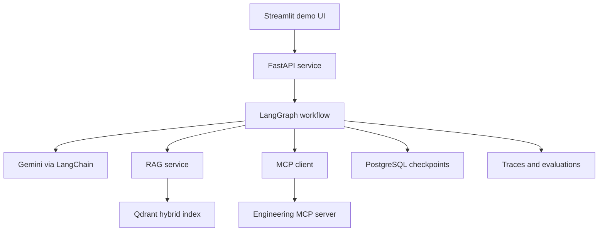
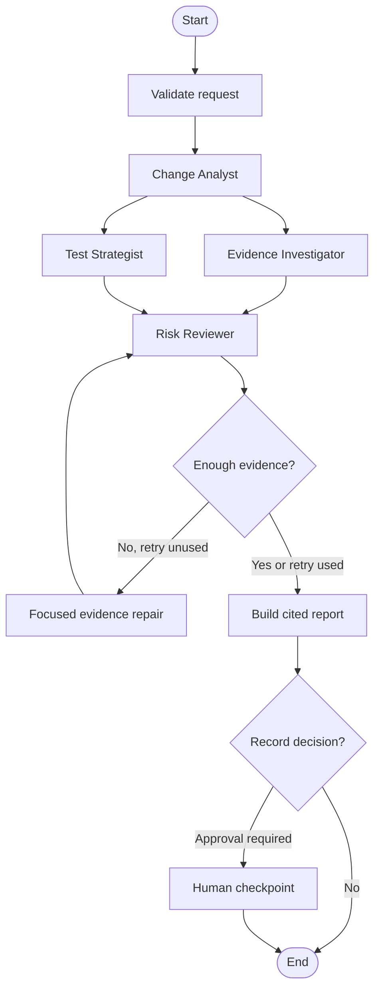
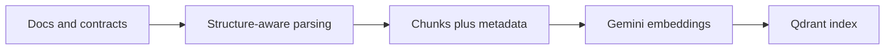

# SentinelFlow

## Agentic Release Intelligence and AI Quality Gate

**Build window:** 7 focused days, approximately 45 to 55 hours  
**Primary goal:** Create an interview-ready, production-shaped AI engineering project using MCP, RAG, four specialist agents, LangChain, LangGraph, FastAPI, and an LLM.  
**Portfolio positioning:** Applied AI Engineer, AI Engineer, AI Quality Engineer, AI Test Engineer, Generative AI Engineer, and ML Engineer.

---

## 1. Executive decision

Build **SentinelFlow**, an evidence-grounded system that analyzes a proposed software change and answers three questions:

1. What components and user journeys could break?
2. What evidence and tests support that conclusion?
3. Should the release pass, require human review, or be blocked?

The user submits a change ID or patch. SentinelFlow collects the change package through MCP, retrieves requirements, API contracts, test cases, runbooks, and past incidents through RAG, coordinates four specialist agents through LangGraph, and produces a cited release-readiness report.

The demonstration domain will be a synthetic healthcare claims platform because it matches Sukumar's regulated-industry and QA experience. The engineering problem remains universal: dependency analysis, retrieval, test selection, auditability, and safe tool use apply equally to commerce, finance, ads, infrastructure, and consumer products.

### One-line pitch

> SentinelFlow is a multi-agent release-risk copilot that turns code and requirement changes into an evidence-backed impact analysis, prioritized regression plan, and auditable release decision.

### Why this project wins

- It combines AI engineering with a credible domain advantage instead of hiding eight years of QA experience.
- RAG is essential because the answer depends on private requirements, contracts, incidents, and tests.
- MCP is essential because the agents must obtain live change data, inspect the service catalog, select tests, and optionally record a decision.
- Multiple agents are justified by separate expertise, tools, inputs, and output contracts.
- The output is objectively testable. Seeded changes have known impacted services, required tests, and expected release decisions.
- It demonstrates production judgment: bounded loops, structured outputs, provenance, human approval, observability, evaluation, and cost controls.

---

## 2. Evidence-based project selection

The supplied **AI/ML Job Market Intelligence Report** analyzed 76 non-duplicate job descriptions. Its strongest relevant signals directly shape this design.

| Market signal from the report | Frequency | SentinelFlow response |
|---|---:|---|
| Python | 80.3% | Python 3.12 backend and tooling |
| LLMs | 68.4% | Configurable LLM provider with structured outputs |
| Monitoring and observability | 63.2% | Per-node traces, latency, tokens, cost, retrieval scores, and errors |
| AI agents and agentic workflows | 51.3% | Four specialists with explicit contracts and bounded orchestration |
| REST or gRPC APIs | 48.7% | Typed FastAPI endpoints and generated OpenAPI documentation |
| System design | 42.1% | Stateless API, external persistence, failure boundaries, and scale plan |
| CI/CD | 42.1% | GitHub Actions for lint, type checks, tests, evaluation smoke tests, and image build |
| Docker | 38.2% | Reproducible local and Cloud Run deployment |
| RAG | 36.8% | Hybrid retrieval over requirements, contracts, incidents, policies, and tests |
| Regulated industry and compliance | 34.2% | Synthetic healthcare domain, audit trail, and approval gates |
| LangChain or LlamaIndex | 23.7% | LangChain loaders, splitters, retrievers, model abstraction, and prompts |
| Model evaluation and validation | 18.4% | Golden dataset, retrieval metrics, trajectory checks, and regression gates |
| LLM evaluation frameworks | 17.1% | Deterministic evaluators plus optional LLM-as-judge |
| MCP | 5.3% | A high-signal, real integration boundary for engineering systems |

The report recommends DocuMind first, but estimates three to four weeks for a polished version. SentinelFlow narrows the data types and user journey enough to fit one week while adding stronger personal differentiation.

### Candidate comparison

Scores are directional, from 1 to 5, and prioritize a one-week portfolio build rather than a hypothetical enterprise implementation.

| Candidate | Market coverage | Differentiation | One-week feasibility | Objective evaluation | Interview story | Total |
|---|---:|---:|---:|---:|---:|---:|
| Generic document assistant | 5 | 2 | 4 | 3 | 3 | 17 |
| LLM evaluation platform | 4 | 5 | 3 | 5 | 4 | 21 |
| Incident-response copilot | 5 | 4 | 2 | 3 | 5 | 19 |
| **SentinelFlow** | **5** | **5** | **4** | **5** | **5** | **24** |

### What “FAANG tier” means here

It does not mean pretending a one-week demo serves millions of requests. It means the repository shows the decisions expected at that scale:

- clear service and data boundaries;
- deterministic contracts around nondeterministic models;
- measurable quality and failure behavior;
- safe external actions;
- observability and replayability;
- explicit local, portfolio-cloud, and production evolution paths.

---

## 3. Product definition

### Target users

- QA leads and software development engineers in test
- release managers
- backend and platform engineers
- engineering managers reviewing risky changes

### Core input

```json
{
  "change_id": "CHG-104",
  "objective": "Assess release risk and generate the minimum sufficient regression plan",
  "execute_tests": false
}
```

### Core output

```json
{
  "analysis_id": "anl_01K...",
  "decision": "BLOCK",
  "risk_score": 87,
  "confidence": 0.91,
  "impacted_services": ["claims-api", "notification-worker", "analytics-consumer"],
  "critical_findings": [
    {
      "finding": "The change removes a required response field used by two downstream consumers.",
      "evidence_ids": ["openapi-claims-v3#claim-response", "inc-017#root-cause"]
    }
  ],
  "recommended_tests": ["contract_claim_response", "notification_status_mapping"],
  "evidence_coverage": 0.93,
  "agent_steps": 5,
  "requires_human_approval": true
}
```

### Three-minute demo story

1. Select `CHG-104`, a seeded breaking change to the claims API.
2. Watch four agent stages stream through the UI.
3. Open the impact graph, citations, and prioritized tests.
4. Show that SentinelFlow identifies an indirect analytics consumer and a related past incident.
5. Show the `BLOCK` recommendation and its evidence coverage.
6. Attempt to record the decision, triggering a human approval checkpoint.
7. Open the trace and evaluation dashboard to show latency, tool calls, token use, and expected-versus-actual results.

---

## 4. One-week scope boundary

### Must ship

- Four specialist agents, excluding deterministic orchestration nodes
- One LangGraph workflow with conditional routing and at most one repair loop
- One official Python MCP server with at least four tools and two resources
- Hybrid RAG over a synthetic but realistic engineering knowledge base
- Cited findings with stable document and section IDs
- FastAPI endpoints, asynchronous graph execution, and progress streaming
- A minimal Streamlit user interface
- SQLite for local development and PostgreSQL configuration for deployed persistence
- Qdrant local or cloud configuration
- At least 20 golden evaluation scenarios
- Unit, integration, graph-route, MCP-contract, and evaluation tests
- Docker, Docker Compose, GitHub Actions, and one Cloud Run deployment
- Architecture diagram, API examples, evaluation results, and a short demo video

### Stretch only after the definition of done

- Real GitHub read-only integration
- Reranking model
- Dependency graph visualization
- Analyst feedback collection
- A second LLM provider comparison
- Automatic draft comment on a pull request

### Explicitly out of scope

- Jira or GitHub OAuth flows
- Kubernetes
- Kafka, Redis, or a distributed worker queue
- Arbitrary code execution from an untrusted repository
- Fine-tuning
- Multi-tenant authorization
- PHI or proprietary company data
- Fully autonomous release approval

These exclusions protect the one-week deadline. Kubernetes confetti does not turn a rushed demo into a distributed system.

---

## 5. System architecture



### Runtime responsibilities

| Layer | Responsibility | One-week implementation |
|---|---|---|
| UI | Submit change, display progress and report | Streamlit, three pages |
| API | Validation, auth placeholder, job lifecycle, OpenAPI | FastAPI and Pydantic |
| Workflow | State, routing, retries, interrupts, streaming | LangGraph `StateGraph` |
| Agent logic | Specialized reasoning with typed output | LangChain prompts and structured output |
| RAG | Ingestion, hybrid retrieval, evidence formatting | LangChain plus Qdrant |
| Tool boundary | Dynamic engineering context and actions | Official MCP Python SDK |
| Persistence | Checkpoints and analysis history | SQLite locally, PostgreSQL when deployed |
| Observability | Traces, metrics, errors, evaluation runs | LangSmith plus structured JSON logs |

---

## 6. Why each required technology is present

| Technology | Exact role | Why it is not redundant |
|---|---|---|
| LLM | Interpret change intent, infer risk hypotheses, synthesize evidence | Deterministic code cannot reliably map varied change descriptions to semantic risks |
| LangChain | Model abstraction, document loaders, splitters, retrievers, prompts, structured output | Keeps LLM and retrieval components replaceable and testable |
| LangGraph | Explicit state machine, parallel branches, conditional retry, persistence, human interrupt | The workflow has dependencies and cycles that a simple LangChain sequence should not hide |
| RAG | Ground analysis in internal requirements, contracts, incidents, policies, and tests | Model memory cannot know the synthetic organization's current facts |
| MCP | Standardized access to change packages, service catalog, test inventory, test runner, and audit action | Separates agent reasoning from external system adapters and schemas |
| FastAPI | Typed application boundary, async execution, status endpoints, streaming, OpenAPI | Makes the system consumable as a service rather than a notebook demo |

---

## 7. Agent design

There are **four specialist agents**. The intake validator, router, approval gate, and report formatter are deterministic nodes and do not count toward the minimum.

| Agent | Mission | Allowed context and tools | Typed output | Why separate |
|---|---|---|---|---|
| 1. Change Analyst | Convert the ticket and diff into impacted components, contracts, data flows, and initial risk hypotheses | MCP `get_change_package`, MCP `get_service_dependencies` | `ChangeImpact` | Code-change reasoning needs repo and dependency context, not policy documents |
| 2. Evidence Investigator | Find authoritative support or contradictions for every risk hypothesis | RAG retriever only | `EvidenceBundle` with citations and coverage | Retrieval can be optimized and evaluated independently from planning |
| 3. Test Strategist | Produce the smallest high-value test plan and optionally run safe tests | MCP `list_tests`, MCP `run_tests` | `RegressionPlan` | Test selection has its own constraints, coverage goals, and tool permissions |
| 4. Risk Reviewer | Challenge unsupported claims, detect missing evidence, score risk, and recommend PASS, REVIEW, or BLOCK | Read-only structured outputs from the other agents | `GateAssessment` | An independent critic reduces self-confirmation and owns the final rubric |

### Agent rules

- Every output must conform to a Pydantic schema.
- Temperature stays between 0 and 0.2.
- Agents receive only the minimum context required for their role.
- Evidence IDs must exist in retrieved context. A validator rejects invented IDs.
- Agents cannot directly approve a release.
- The workflow allows no more than five normal LLM calls and one repair call per analysis.
- Tool inputs are validated before an MCP call and tool outputs are treated as untrusted data.

---

## 8. LangGraph workflow



### Shared state

```python
class SentinelState(TypedDict):
    analysis_id: str
    request: AnalysisRequest
    change_impact: ChangeImpact | None
    evidence: EvidenceBundle | None
    regression_plan: RegressionPlan | None
    gate_assessment: GateAssessment | None
    evidence_gaps: list[str]
    retry_count: int
    approval_status: Literal["not_requested", "pending", "approved", "rejected"]
    trace_metrics: TraceMetrics
    final_report: ReleaseReport | None
```

### Routing rules

| Condition | Route |
|---|---|
| Invalid request or missing change package | Stop with typed `INPUT_ERROR` |
| Evidence coverage below 0.75 and retry count is 0 | Run one focused retrieval repair |
| Evidence still weak after repair | Return `REVIEW`, never fabricate certainty |
| Critical breaking change has authoritative evidence | Return `BLOCK` |
| No critical risks and required tests pass | Return `PASS` recommendation |
| Any external write is requested | Pause at human checkpoint |

This is a controlled workflow with agentic nodes, not an unrestricted group chat. LangGraph is the control plane, while agents supply bounded judgment.

---

## 9. MCP design

### Server

Create `engineering-context-mcp` using the official MCP Python SDK. Run it over `stdio` during local development and Streamable HTTP for the deployed demo. Keep it as a separate module, even if it shares the MVP container with FastAPI.

### MCP tools

| Tool | Access | Purpose | Important guardrail |
|---|---|---|---|
| `get_change_package(change_id)` | Read | Return ticket, diff, files changed, author notes, and commit metadata | Allowlisted fixture IDs in MVP |
| `get_service_dependencies(service_names)` | Read | Return upstream and downstream dependencies from the service catalog | Maximum component count |
| `list_tests(components, risk_tags)` | Read | Return matching unit, contract, API, integration, and regression tests | Stable IDs and metadata only |
| `run_tests(test_ids, dry_run=true)` | Execute | Run only allowlisted local test IDs | `dry_run=true` default, timeout, no shell input |
| `record_gate_decision(analysis_id, decision, evidence_hash)` | Write | Append an auditable decision event | Human approval and idempotency key required |

### MCP resources

| Resource URI | Content |
|---|---|
| `service-catalog://current` | Services, owners, dependencies, criticality, and data classification |
| `release-policy://current` | Risk rubric, blocking rules, required approvals, and test requirements |

### MCP versus RAG boundary

- MCP serves dynamic system state and performs controlled actions.
- RAG searches the larger, mostly read-only knowledge corpus.
- The RAG service may ingest snapshots obtained from MCP resources, but agents should not use MCP as a disguised vector database.
- This separation makes the architecture explainable and lets external integrations change without rewriting agent prompts.

---

## 10. RAG design

### Knowledge corpus

Create 40 to 60 synthetic artifacts across three services:

- product requirements and acceptance criteria;
- OpenAPI contracts;
- architecture decision records;
- test plans and test case summaries;
- release policies;
- runbooks;
- post-incident reviews;
- service ownership and dependency notes.

The sample system contains `claims-api`, `notification-worker`, and `analytics-consumer`. All names and data are synthetic, with no PHI.

### Ingestion pipeline



### Chunking

- Markdown: split by headings, then cap large sections by tokens.
- OpenAPI YAML: split by endpoint and schema object.
- Incident reports: preserve symptom, root cause, impact, detection, and remediation sections.
- Test inventory: one test or tightly related suite per record.
- Target 350 to 700 tokens per chunk with 10 to 15 percent overlap only where prose continuity requires it.

### Required metadata

```json
{
  "document_id": "openapi-claims-v3",
  "section_id": "claim-response",
  "document_type": "api_contract",
  "service": "claims-api",
  "version": "3.0",
  "effective_date": "2026-07-01",
  "source_path": "knowledge/contracts/claims-openapi.yaml"
}
```

### Retrieval pipeline

1. Convert each risk hypothesis into one or more focused search queries.
2. Apply service, document-type, and version filters when available.
3. Retrieve dense semantic and sparse keyword candidates from Qdrant.
4. Merge candidates with reciprocal-rank fusion.
5. Deduplicate by `document_id` and `section_id`.
6. Return the top 6 to 10 chunks with scores and stable citations.
7. Mark unsupported hypotheses instead of forcing an answer.

### Model choices

- Generation: `gemini-3.5-flash` as the default current model, behind LangChain's provider abstraction.
- Fallback: an OpenRouter model selected through configuration, not hardcoded inside agents.
- Embeddings: `gemini-embedding-001` for the simplest hosted path.
- Offline alternative: FastEmbed with a small BGE-family model if API access is unavailable.

Model names belong in environment configuration because provider catalogs change faster than repository architecture.

---

## 11. FastAPI contract

| Method | Endpoint | Purpose |
|---|---|---|
| `POST` | `/v1/analyses` | Create an analysis and return its ID |
| `GET` | `/v1/analyses/{analysis_id}` | Return status and the latest persisted result |
| `GET` | `/v1/analyses/{analysis_id}/events` | Stream agent progress and partial status through SSE |
| `POST` | `/v1/analyses/{analysis_id}/decision` | Approve or reject recording the gate decision |
| `POST` | `/v1/knowledge/ingest` | Ingest allowlisted knowledge files |
| `POST` | `/v1/evaluations/run` | Run the golden evaluation suite |
| `GET` | `/health/live` | Process liveness |
| `GET` | `/health/ready` | LLM, database, vector store, and MCP readiness |
| `GET` | `/metrics` | Prometheus-compatible metrics if time permits |

### API behavior

- Use Pydantic request and response models for every endpoint.
- Generate an idempotency key for analysis creation and decision recording.
- Return machine-readable error codes such as `MCP_TIMEOUT`, `RETRIEVAL_EMPTY`, and `LLM_SCHEMA_ERROR`.
- Inject LLM, retriever, MCP client, and persistence implementations through FastAPI dependencies so tests can replace them with fakes.
- Redact prompts, secrets, and document bodies from application logs.

---

## 12. Persistence and job lifecycle

### Local development

- LangGraph `SqliteSaver` for checkpoints
- SQLite table for analysis metadata and audit events
- Local Qdrant container

### Deployed demo

- LangGraph `AsyncPostgresSaver`
- Neon PostgreSQL or another managed PostgreSQL database
- Qdrant Cloud free cluster or the local Qdrant container for a single-instance demonstration

Every graph invocation uses `analysis_id` as its thread ID. Checkpoints permit replay, one human approval interrupt, and recovery from the last successful node.

### Production evolution

- Move long-running analyses to a queue-backed worker service.
- Keep FastAPI stateless and store all job state externally.
- Scale API and worker services independently.
- Add tenant-scoped authorization and row-level access controls.

The queue is documented but deliberately not built during the one-week MVP.

---

## 13. Evaluation strategy

Evaluation is a first-class feature, not a README promise.

### Golden dataset

Create at least 20 seeded scenarios:

| Category | Count | Example |
|---|---:|---|
| API contract changes | 6 | Removed required field, enum change, response-code change |
| Authentication and security | 4 | Token TTL, authorization rule, sensitive-log change |
| Data schema and event changes | 4 | Renamed event field, nullable column, consumer mismatch |
| Configuration and dependency changes | 3 | Timeout, retry count, downstream version |
| Safe or low-risk changes | 3 | Documentation, additive optional field, isolated UI copy |

Each scenario includes expected impacted services, required evidence IDs, required tests, critical risks, and expected decision.

### Metrics and MVP targets

Targets are acceptance criteria, not results to claim before measurement.

| Layer | Metric | Target |
|---|---|---:|
| Retrieval | Recall@5 for required evidence | at least 0.80 |
| Retrieval | Citation validity | 1.00 |
| Grounding | Claims supported by cited evidence | at least 0.90 |
| Change analysis | Critical impacted-service recall | at least 0.85 |
| Test planning | Required-test recall | at least 0.85 |
| Tool use | Valid tool name and schema | 1.00 |
| Workflow | Expected agent trajectory | at least 0.95 |
| Decision | PASS, REVIEW, BLOCK accuracy | at least 0.85 |
| Reliability | Successful completion without manual retry | at least 0.95 |
| System | Maximum evidence repair loops | 1 |

### Evaluators

- Deterministic exact and set-based checks for services, tests, tools, citations, and decisions
- Retrieval metrics computed from golden evidence IDs
- Trajectory evaluator for expected nodes and forbidden tools
- Schema-validity evaluator for every agent output
- Optional LLM-as-judge for completeness and groundedness, calibrated against five manually scored cases
- Regression comparison in CI on a small deterministic subset

Do not place the full paid LLM evaluation suite on every commit. Use mocked unit tests and a small smoke set in CI, then run the full suite manually before a release.

---

## 14. Observability and reliability

### Trace every analysis

- `analysis_id` and trace ID
- agent and graph node
- prompt version and model name
- MCP tool name, duration, status, and retry count
- retrieval query, filters, document IDs, and scores
- input, output, and total tokens
- estimated request cost
- node and end-to-end latency
- schema validation failures
- final decision, confidence, and evidence coverage

### Reliability policies

- Timeout every LLM, vector-store, database, and MCP operation.
- Retry only transient failures, with exponential backoff and jitter.
- Never retry a non-idempotent write without the same idempotency key.
- Cap the full graph by steps, tokens, elapsed time, and repair count.
- Return a partial `REVIEW` report when evidence or a dependency is unavailable.
- Keep application logs in JSON and use correlation IDs across FastAPI, LangGraph, and MCP.

### Portfolio SLOs

| SLO | Target |
|---|---:|
| API availability during demo | 99% best effort |
| Analysis completion | at least 95% |
| Cached analysis p95 | under 2 seconds |
| New analysis p95 | under 30 seconds |
| MCP read-tool p95 | under 500 ms locally |
| Citation validity | 100% |

The LLM provider is likely to dominate latency and rate limits. Use a bounded semaphore and expose backpressure rather than launching unlimited agent calls.

---

## 15. Security and responsible-agent design

| Risk | Control |
|---|---|
| Prompt injection inside tickets, diffs, or documents | Label external content as data, isolate instructions, allowlist tools, validate output |
| Hallucinated citations | Stable IDs plus post-generation citation validator |
| Dangerous test execution | Allowlisted test IDs, no raw shell arguments, timeout, resource limits, dry-run default |
| Unauthorized external write | LangGraph human interrupt before `record_gate_decision` |
| Secret leakage | Environment variables or secret manager, log redaction, no secrets in prompts |
| Excessive model cost | Token budget, step limit, retrieval cap, caching, model configuration |
| Sensitive healthcare data | Synthetic data only, explicit no-PHI policy |
| False confidence | Evidence-coverage threshold and forced `REVIEW` fallback |

The system recommends a release decision. It does not autonomously deploy or approve production code.

---

## 16. Repository structure

```text
sentinelflow/
├── .github/workflows/ci.yml
├── app/
│   ├── api/                 # FastAPI routers and schemas
│   ├── agents/              # Four agent prompts, contracts, and nodes
│   ├── graph/               # State, routing, workflow, checkpoint setup
│   ├── rag/                 # Ingestion, retrieval, citations, evaluation
│   ├── mcp_client/          # MCP session and typed adapters
│   ├── observability/       # Logging, tracing, metrics, cost estimates
│   ├── persistence/         # SQLite and PostgreSQL adapters
│   ├── core/                # Settings, errors, IDs, model factory
│   └── main.py
├── mcp_server/
│   ├── server.py
│   ├── tools.py
│   ├── resources.py
│   └── fixtures/
├── knowledge/
│   ├── requirements/
│   ├── contracts/
│   ├── incidents/
│   ├── policies/
│   └── tests/
├── evals/
│   ├── golden_cases.jsonl
│   ├── evaluators.py
│   └── run_eval.py
├── tests/
│   ├── unit/
│   ├── integration/
│   ├── contract/
│   └── graph/
├── ui/
│   └── streamlit_app.py
├── docs/
│   ├── architecture.md
│   ├── evaluation.md
│   ├── demo-script.md
│   └── adr/
├── Dockerfile
├── compose.yaml
├── pyproject.toml
├── Makefile
├── .env.example
├── LICENSE
└── README.md
```

### Engineering conventions

- Python 3.12, `uv`, Ruff, mypy, pytest, and pre-commit
- Pydantic v2 for domain and API contracts
- Prompt files versioned with tests
- Conventional commits and small pull requests
- Architecture decision records for MCP boundary, graph design, retrieval, and persistence

---

## 17. Seven-day execution plan

### Assumption

This schedule assumes 45 to 55 focused hours and aggressive use of coding agents. If only 2 to 3 hours per day are available, keep the project local, remove PostgreSQL and Cloud Run, and ship the same technical core in 10 to 14 days.

| Day | Build focus | Required deliverable | End-of-day gate |
|---|---|---|---|
| 1 | Product contract, repo skeleton, fixtures, schemas | FastAPI skeleton, typed domain models, 3 seeded changes, 20 golden case outlines | `pytest`, Ruff, and mypy pass |
| 2 | MCP server and client | Four read or execute tools, two resources, MCP Inspector screenshots, contract tests | Agents can retrieve a change and test catalog only through MCP |
| 3 | RAG ingestion and retrieval | 40 to 60 artifacts, structure-aware chunking, Qdrant index, citations, retrieval evaluator | Recall@5 reaches 0.80 on a 10-case retrieval subset |
| 4 | Four agents and LangGraph | Agent prompts, structured outputs, fan-out, reviewer, one repair route, checkpointing | Three seeded cases complete with correct routes and no invented citations |
| 5 | FastAPI lifecycle and UI | Create, status, SSE, decision endpoints, three-page Streamlit UI | Full demo works locally through the API, not direct Python calls |
| 6 | Evaluation, security, observability | Full golden suite, traces, timeouts, budgets, injection tests, Docker Compose, CI | Metrics table generated and critical tests pass in CI |
| 7 | Deployment and portfolio polish | Cloud Run URL, README, diagrams, ADRs, screenshots, 3-minute demo video, resume bullets | Fresh clone setup succeeds and demo script is repeatable |

### Daily cut rule

At the final two hours of each day, stop adding features. Run tests, update the README, save screenshots, and create the next day's issue list. A portfolio project is judged by what reliably works, not by the graveyard of 14 half-connected services.

---

## 18. Using Codex, Cursor, and Antigravity effectively

### Recommended division

| Tool | Best use in this build |
|---|---|
| Codex | Architecture, repository-wide scaffolding, API and graph contracts, test generation, code review, CI, and documentation |
| Cursor | Fast implementation loops, debugging failing tests, refactoring individual modules, and tracing data flow across files |
| Antigravity | Rapid UI iteration, demo polish, exploring provider integrations, and producing alternate implementations when blocked |

### Coordination rules

- Keep one human-owned task board with acceptance criteria per issue.
- Let only one tool edit a module at a time.
- Give each tool the relevant contract, test, and file list, not the entire vague project prompt.
- Require every generated change to include or update tests.
- Commit after each vertical slice: MCP, RAG, graph, API, evaluation, deployment.
- Ask a different tool to review high-risk code than the tool that authored it.
- Never paste secrets into a prompt or commit `.env` files.

### Example task prompt for an AI coding tool

```text
Implement MCP tool get_change_package in mcp_server/tools.py.
Follow the ChangePackage schema in app/core/models.py.
Only allow fixture IDs matching CHG-[0-9]{3}.
Return a typed NOT_FOUND error for unknown IDs.
Do not accept file paths or shell commands.
Add contract and negative tests. Run the targeted tests and report results.
Do not change unrelated files.
```

This produces safer, reviewable increments than repeatedly asking an agent to “finish the app.”

---

## 19. Test plan

### Unit tests

- schema validation and serialization
- risk score calculation
- routing conditions
- citation validation
- token and step budgets
- error mapping

### MCP contract tests

- tool discovery and input schemas
- valid and invalid change IDs
- allowlisted test execution
- dry-run default
- timeout and idempotency behavior
- approval required for write tool

### RAG tests

- deterministic chunk IDs
- metadata completeness
- version and service filters
- retrieval on known evidence queries
- no result and conflicting-result behavior

### Graph tests

- PASS path
- REVIEW path after insufficient evidence
- BLOCK path for a breaking contract
- exactly one repair loop
- MCP and LLM failure fallback
- pause and resume at human approval

### Security tests

- ticket containing “ignore prior instructions”
- document containing a fake tool request
- invented citation from model output
- arbitrary test ID
- shell metacharacters in tool inputs
- repeated decision write using the same idempotency key

---

## 20. Deployment plan

### Local

`Docker Compose` runs:

1. FastAPI and the mounted MCP server
2. Qdrant
3. PostgreSQL, or SQLite for the lightest setup
4. Streamlit UI

### Portfolio cloud

- Deploy the API and MCP application as a Docker container to Google Cloud Run.
- Deploy the Streamlit UI either in the same container for simplicity or as a second Cloud Run service.
- Use managed PostgreSQL for persistent checkpoints and Qdrant Cloud for retrieval.
- Set Cloud Run minimum instances to zero for a low-traffic portfolio demo.
- Store secrets in Google Secret Manager or the platform's secret configuration.
- Add a startup readiness check, request timeout, memory limit, and maximum instance cap.

Cloud Run can scale to zero when idle, which is a good fit for bursty portfolio traffic. The first request may experience a cold start, so the README and demo script should include a short warm-up call.

### Production evolution

- Separate API, worker, and MCP deployments.
- Add queue-based execution and per-tenant rate limits.
- Place write-capable MCP tools behind stronger authorization.
- Add encrypted checkpoints, audit retention, backup, and disaster recovery.
- Replace the single Qdrant collection with tenant isolation and lifecycle policies.

---

## 21. Definition of done

The project is complete only when all of the following are true:

- [ ] Four specialist agents appear in code, traces, and documentation.
- [ ] The LangGraph has typed state, conditional routing, and one bounded cycle.
- [ ] MCP tools are invoked through an MCP client, not imported as ordinary Python functions.
- [ ] RAG answers include stable, validated citations.
- [ ] A user can complete the entire demo through FastAPI and the UI.
- [ ] A write action pauses for human approval and resumes correctly.
- [ ] At least 20 golden scenarios run and produce a saved metrics table.
- [ ] CI runs lint, type checks, unit tests, graph tests, and an evaluation smoke set.
- [ ] Docker Compose starts the local system from a fresh clone.
- [ ] The deployed demo uses synthetic data and contains no secrets.
- [ ] README includes architecture, tradeoffs, failure modes, measured results, and scale evolution.
- [ ] A three-minute demo video and a concise system-design walkthrough exist.

---

## 22. README story and interview defense

### README sections

1. Problem and product demo
2. Why four agents
3. Architecture
4. MCP tool and resource boundary
5. RAG ingestion and retrieval
6. LangGraph state and routing
7. Evaluation methodology and measured results
8. Security and human approval
9. Local setup
10. Cloud deployment
11. Failure modes and scaling path
12. Tradeoffs and future work

### Likely interview questions

**Why not one agent with all tools?**  
Because separate specialists reduce context and tool exposure, use different evaluation rubrics, and make failures attributable. The deterministic graph owns coordination and limits.

**Why LangGraph if LangChain can call tools?**  
LangChain supplies components. LangGraph makes state, parallel branches, conditional retry, persistence, and approval interruption explicit and testable.

**Why MCP instead of ordinary Python functions?**  
The engineering systems are an external integration boundary. MCP standardizes discovery, schemas, transports, resources, and tool calls, allowing a GitHub or Jira adapter to replace fixtures without rewriting the agent workflow.

**Why use RAG and MCP together?**  
RAG searches a large knowledge corpus. MCP accesses live state and controlled actions. They solve different problems.

**What happens when retrieval is weak?**  
The reviewer requests one focused repair. If evidence remains weak, the system returns `REVIEW` with explicit gaps.

**How would this scale?**  
Keep FastAPI stateless, persist graph state externally, queue analyses, scale workers independently, use provider-specific concurrency limits, cache immutable artifacts, and partition vector data by tenant.

**How do you know it works?**  
Seeded scenarios provide known impacts, evidence, tests, tool trajectories, and decisions. The system reports retrieval, grounding, planning, route, decision, reliability, latency, and cost metrics.

---

## 23. Resume and LinkedIn bullets

Use measured values only after the evaluation run. Replace bracketed placeholders with real results.

- Built and deployed SentinelFlow, a four-agent release-intelligence platform using LangGraph, LangChain, MCP, RAG, and FastAPI to generate cited change-impact analyses and risk-based regression plans across a synthetic microservice system.
- Designed an auditable agent workflow with typed state, parallel specialists, bounded evidence repair, PostgreSQL checkpointing, and human approval for write actions, achieving **[X%] critical-risk recall** and **[Y%] citation validity** across **[N] golden scenarios**.
- Implemented hybrid retrieval over requirements, API contracts, incidents, and test assets with Qdrant, plus end-to-end observability for model tokens, cost, latency, retrieval scores, tool calls, and decision traces.

### Short LinkedIn description

> SentinelFlow is an evidence-grounded AI quality gate that reviews software changes before release. Four specialized agents analyze impact, retrieve organizational evidence, design a regression plan, and independently challenge the final recommendation. LangGraph controls the workflow, MCP connects engineering tools, RAG provides cited internal knowledge, and FastAPI exposes the system as a deployable service.

---

## 24. Major risks and cut order

| Risk | Early signal | Mitigation | First cut if needed |
|---|---|---|---|
| Synthetic corpus takes too long | Less than 30 artifacts by Day 2 | Generate from consistent templates, manually verify golden artifacts | Reduce to 30 high-quality artifacts |
| Hybrid retrieval complexity | Dense retrieval still broken on Day 3 | Ship dense retrieval with metadata filters first | Sparse branch and RRF |
| MCP deployment friction | Remote transport fails on Day 5 | Keep official local transport working and mount in the API container | Separate remote MCP deployment |
| Agent outputs vary too much | Schema or trajectory failures above 10% | Lower temperature, narrow prompts, deterministic routing, more validators | Optional repair logic |
| Evaluation cost or rate limits | Full suite is slow or throttled | Cache by case and prompt version, use a smaller smoke set | LLM-as-judge evaluator |
| UI consumes backend time | Core graph incomplete on Day 5 | Use a plain Streamlit form and tables | Trace visualization polish |
| Cloud deployment blocks delivery | Local Docker is stable but cloud is not | Preserve repeatable local demo and record it | Public URL, never tests or evals |

The cut order preserves the project's proof: MCP, RAG, four agents, graph control, FastAPI, evaluation, and safety. Visual polish is last.

---

## 25. Technical references

- Supplied source: **AI/ML Job Market Intelligence Report**, 77 job descriptions and 76 non-duplicate postings.
- [LangGraph workflows and agents](https://docs.langchain.com/oss/python/langgraph/workflows-agents)
- [LangGraph graph API](https://docs.langchain.com/oss/python/langgraph/graph-api)
- [LangGraph persistence](https://docs.langchain.com/oss/python/langgraph/persistence)
- [LangGraph agentic RAG](https://docs.langchain.com/oss/python/langgraph/agentic-rag)
- [LangSmith evaluation](https://docs.langchain.com/langsmith/evaluation)
- [Evaluating a complex agent](https://docs.langchain.com/langsmith/evaluate-complex-agent)
- [MCP architecture](https://modelcontextprotocol.io/docs/2026-07-28/learn/architecture)
- [Official MCP Python SDK](https://github.com/modelcontextprotocol/python-sdk)
- [FastAPI asynchronous programming](https://fastapi.tiangolo.com/async/)
- [FastAPI dependency injection](https://fastapi.tiangolo.com/tutorial/dependencies/)
- [Qdrant hybrid retrieval integration](https://docs.langchain.com/oss/python/integrations/vectorstores/qdrant)
- [Gemini 3.5 Flash](https://ai.google.dev/gemini-api/docs/models/gemini-3.5-flash)
- [Gemini API pricing](https://ai.google.dev/gemini-api/docs/pricing)
- [Cloud Run overview](https://docs.cloud.google.com/run/docs/overview/what-is-cloud-run)
- [Cloud Run container deployment](https://docs.cloud.google.com/run/docs/deploying)
- [Neon scale to zero](https://neon.com/docs/introduction/scale-to-zero)

---

## Final recommendation

Build SentinelFlow exactly as the bounded MVP above. Do not start with a real GitHub integration, Kubernetes, a queue, or a sophisticated frontend. First make one seeded change travel through MCP, all four agents, RAG citations, the reviewer, FastAPI, persistence, and the evaluation harness. Once that vertical slice works, scale the dataset and polish the demo.

That sequence produces a finished system with evidence of quality, not merely an architecture diagram with excellent ambitions.
